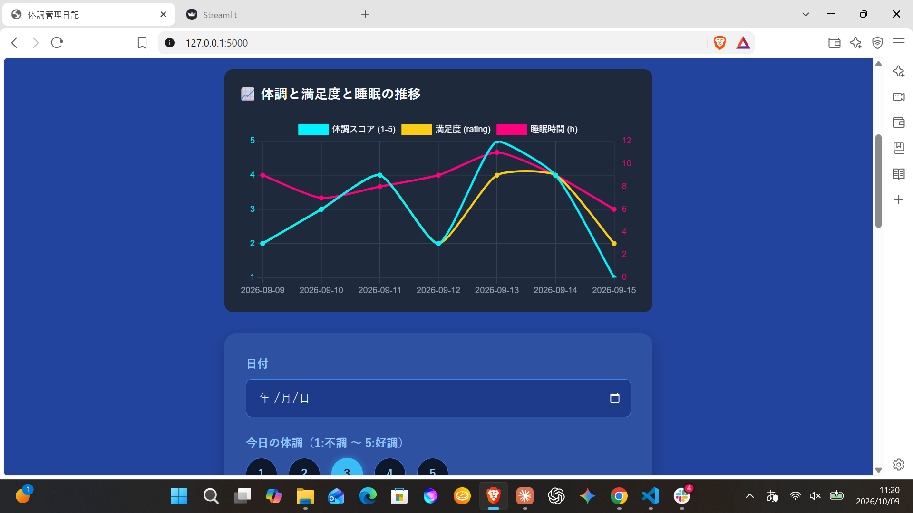
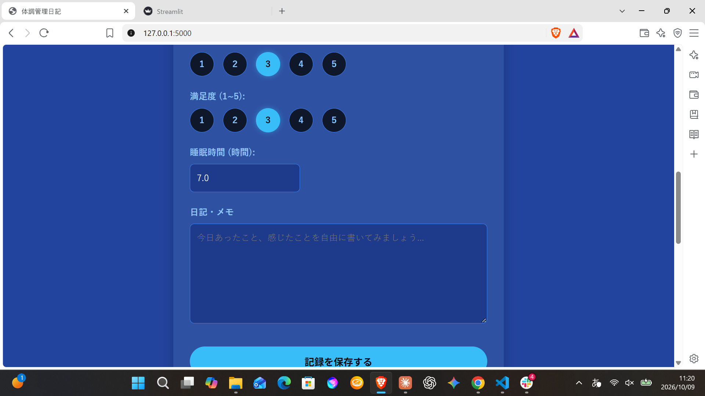

# 🌿 Mood & Health Journal (V1.1)

心と体の状態、睡眠、服用中の薬を記録・可視化し、自分自身の状態を客観的に把握するためのWebアプリケーションです。
「使いやすさ」と「データの安全性」を最優先に、Flaskで設計・開発しました。

> ⚠️ 本アプリは記録と振り返りのためのツールです。診断や治療の助言を行うものではありません。薬の量の変更は、必ず医師・薬剤師の指示に従ってください。

---

## 💡 開発の背景と目的

自分自身のメンタルヘルスや睡眠管理の課題を解決するために作りました。
体調・睡眠・薬の変化を並べて見られるようにして、診察のときに「いつから、どう変わったか」を説明しやすくすることを目指しています。

単に機能を実装するだけでなく、データの流れ（Flask ↔ Jinja2 ↔ ブラウザ）やセキュリティの構造を理解しながら構築しました。

---

## 🖼️ スクリーンショット




## 🛠️ 技術スタック

| カテゴリ | 技術 |
| :--- | :--- |
| **バックエンド** | Python, Flask |
| **フロントエンド** | HTML5, CSS3, Jinja2, Chart.js (2軸グラフ) |
| **データベース** | SQLite3 |
| **セキュリティ** | Werkzeug (パスワードハッシュ化), 環境変数による秘密鍵管理 |
| **開発手法** | AIとのペアプログラミング (ChatGPT, Claude) |

---

## ✨ 主な機能

* **日記の記録・編集・削除：** 日付、体調(1〜5)、満足度(1〜5)、睡眠時間、メモ
* **推移グラフ：** 体調・満足度・睡眠時間を2軸のグラフで可視化
* **月ごとの絞り込み：** 表示する月を選ぶと、一覧とグラフが同じ月に絞られる
* **お薬の管理：** 薬の名前・量・状態（服用中／減薬中／中止）・メモを登録
* **現在のお薬の表示：** 日記のトップに、服用中・減薬中の薬を一覧表示
* **ユーザー登録・ログイン：** 複数人が使っても、データは互いに見えない

---

## 🛡️ セキュリティと技術的こだわり

### 1. ユーザー認証とデータの隔離
* **セッション管理：** Flaskのsessionで「今誰がアクセスしているか」を識別し、個人ごとのデータの独立性を確保。
* **パスワードの保護：** `Werkzeug` のハッシュ化関数を使い、生のパスワードをDBに保存しない。登録時は空欄や短すぎるパスワード(8文字未満)をサーバー側で拒否。
* **SQLインジェクション対策とユーザー隔離：** すべてのクエリでプレースホルダを使用し、セッションの `user_id` で絞り込み。他のユーザーの記録・薬には触れない。

### 2. 公開を想定した設定
* **秘密鍵の環境変数化：** `SECRET_KEY` をコードに書かず、環境変数から読み込む。本番環境で未設定なら起動しない。
* **Cookieの設定：** 本番では `Secure` / `HttpOnly` / `SameSite=Lax` を有効化。
* **デバッグモードの制御：** 環境変数 `FLASK_DEBUG=1` のときだけ有効。
* **DBパスの固定：** サーバー上でも迷子にならないよう、`app.py` と同じ場所の絶対パスで指定。
* **バックアップ：** `backup.py` でSQLiteのバックアップ機能を使い、世代管理しながらコピー。

### 3. PythonとHTML(Jinja2)のデータ連携
* サーバー側のログイン状態に応じた画面の出し分けや、DBのデータのHTMLへの反映を実装。
* Pythonのデータを JSON に変換して Chart.js に渡し、体調と睡眠という異なるスケールのデータを2軸グラフで表示。

### 4. エラーハンドリング
* 入力値の変換エラーや重複登録などを `try-except` で処理し、アプリが止まらずユーザーにメッセージを返す。
* SQLのプレースホルダの数が合わないエラー（`5 values for 6 columns`）のデバッグも経験。

---

## 🤝 AIとのペアプログラミング

開発では、ChatGPTやClaudeなどのAIをペアプログラミングの相手として使いました。AIが出したコードをそのまま採用するのではなく、次の流れで進めています。

1. **自分で決める：** 作りたい機能と、守りたい条件（データの安全性、使いやすさ）を自分で決める。
2. **AIに案とレビューをもらう：** コードの案、バグの指摘、セキュリティ面のチェックを相談する。
3. **読んで理解する：** 出てきたコードの意味を確認し、分からない部分は質問して理解してから取り入れる。
4. **動かして確かめる：** 実際に動かして画面とデータを確認し、エラーが出たら内容を読んで原因を特定、修正する。

**役割の分担**

| AIにお願いしたこと | 自分で判断・実施したこと |
| :--- | :--- |
| コードの案、バグの指摘、セキュリティ面の指摘 | 作る機能の決定、画面や仕様の方針 |
| 設定方法や公開手順の整理 | 動作確認、テンプレートへの反映、公開時の設定 |

**学んだこと**
* AIの出力は便利ですが、間違いや前提のずれが混ざることがあります。動かして確かめ、意味を理解して使うことが大切だと実感しました。
* 「何を作るか」「どこまで安全にするか」を決めるのは自分で、その判断をするために基礎の理解が必要だと分かりました。

---

## 🚀 セットアップ

```bash
# 依存パッケージのインストール
pip install Flask

# 起動
python app.py
```

* 手元でデバッグしたいとき: `FLASK_DEBUG=1 python app.py`
* 公開するときは、環境変数 `SECRET_KEY`（ランダムな文字列）と `APP_ENV=production` を設定してください。
* バックアップ: `python backup.py`

---

## 📂 ディレクトリ構成

```text
mood-journal-app/
├── app.py                 # Flaskアプリ本体（ルーティング・メインロジック）
├── backup.py              # DBバックアップ用スクリプト
├── README.md              # プロジェクトドキュメント
├── .gitignore             # Git管理除外設定（.env、.db、キャッシュなど）
├── static/
│   └── 日記.css           # スタイル
└── templates/
    ├── login.html         # ログイン画面
    ├── sign.html          # 新規登録画面
    ├── journal.html       # 記録入力・グラフ・一覧・現在のお薬
    ├── edit.html          # 記録の編集画面
    └── meds.html          # お薬の管理画面
```

---

## 🔧 今後の改善予定

* **CSRF対策：** Flask-WTFなどを導入して、フォーム送信の安全性を高める。
* **保守性の向上：** DBの結果をタプルのインデックス（`log[5]`）で扱っているため、`sqlite3.Row` を導入し、`log['rating']` のように名前で参照できるようにする。
* **コードの整理：** `save` と `update` の重複部分を関数にまとめる。
* **薬の量の変更履歴：** 量を変えた日を記録し、体調・睡眠のグラフに重ねて表示する。
* **かんたん入力モード：** 体調がつらい日でも続けられるよう、最低限の項目だけで記録できるようにする。
